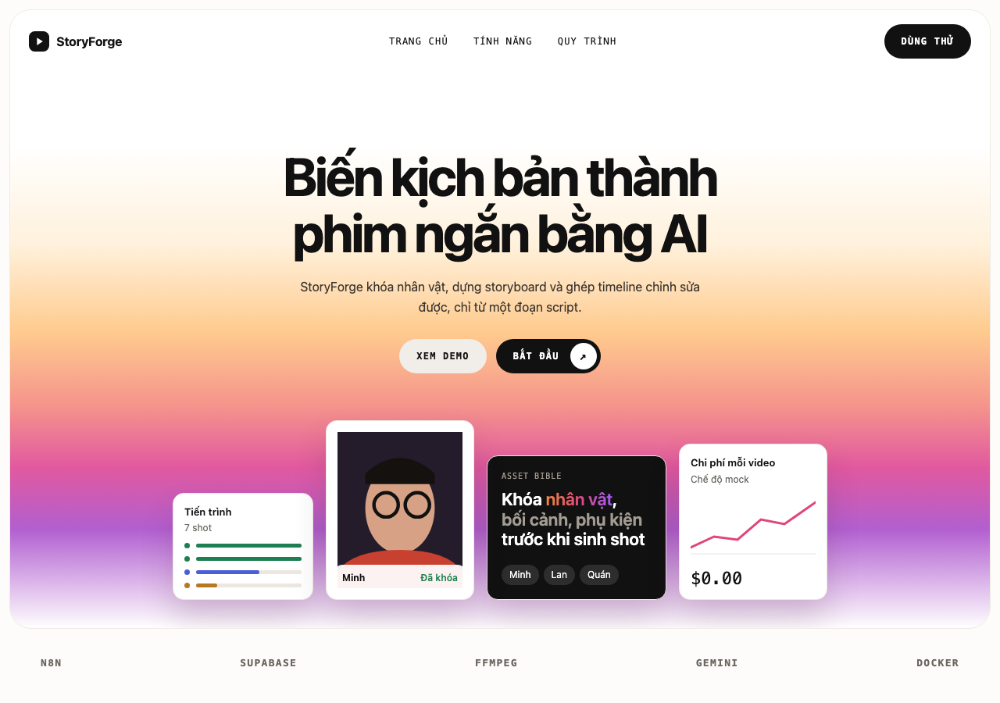
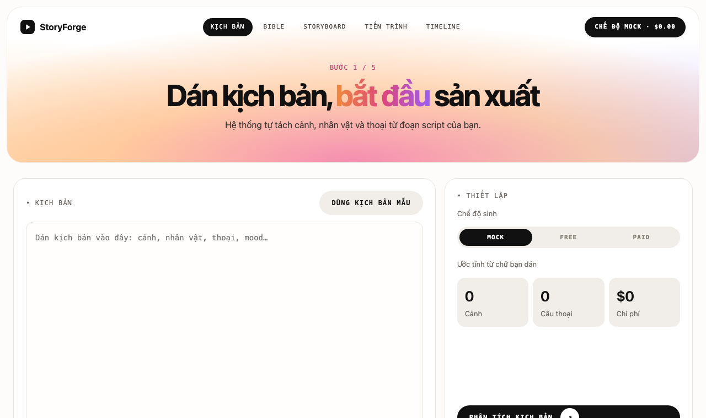
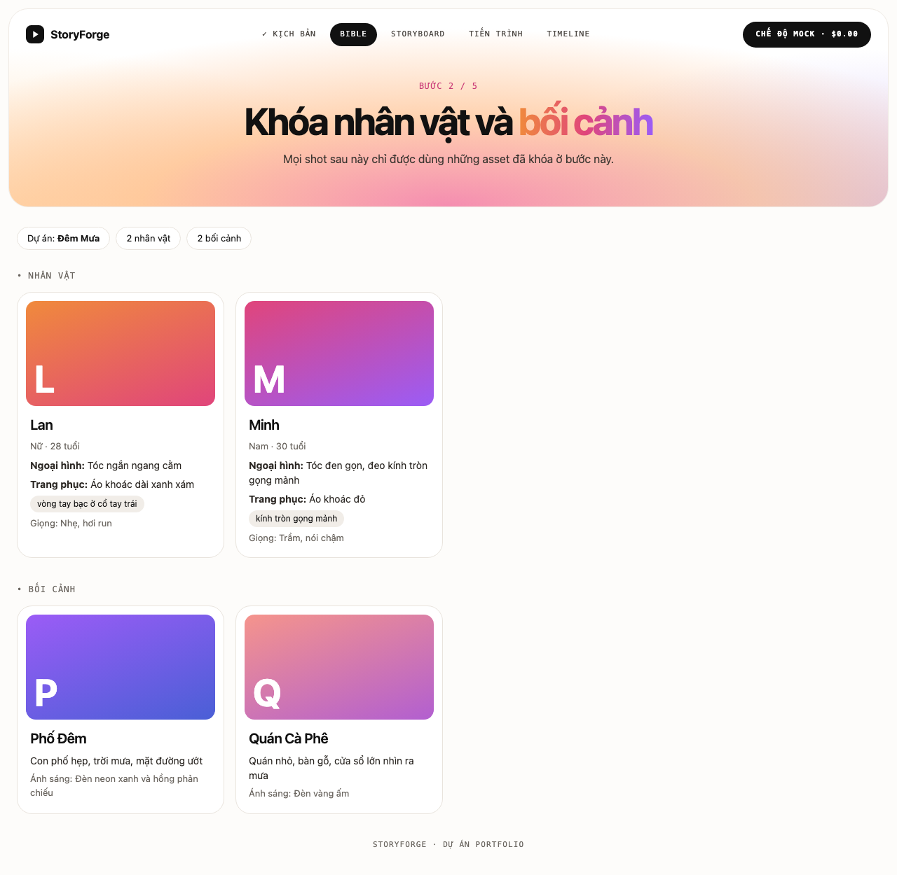
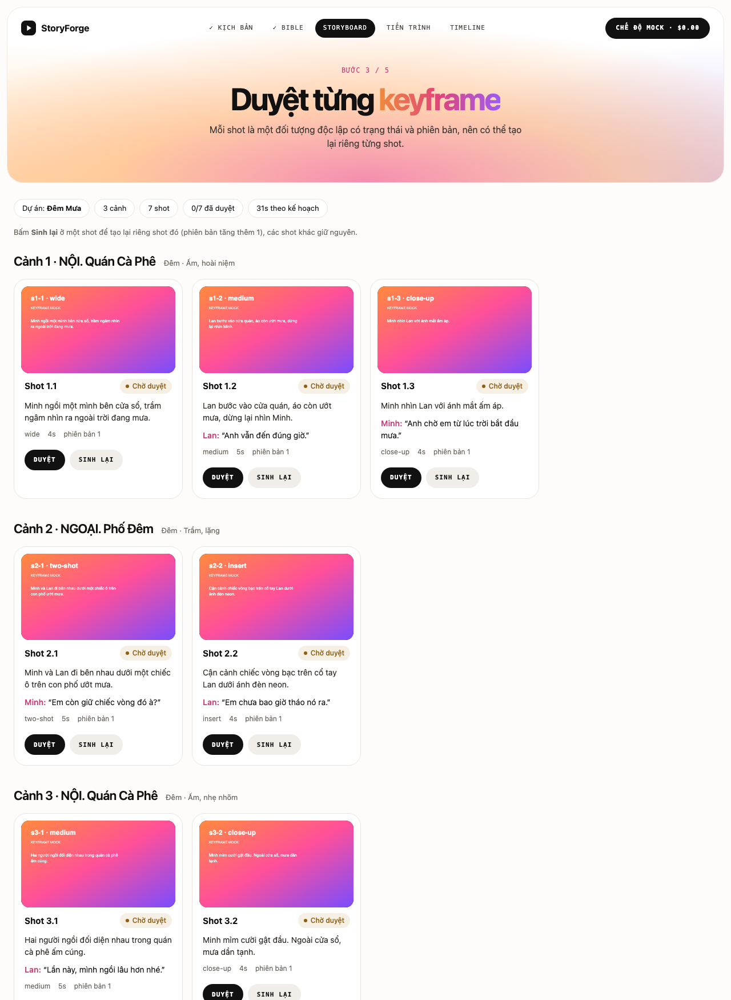
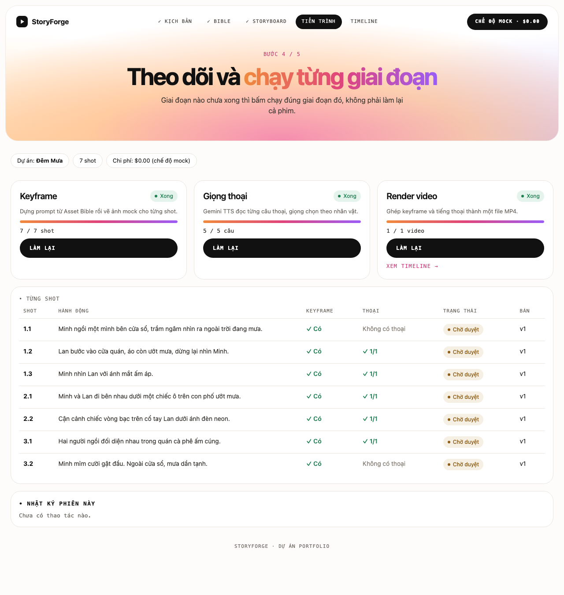
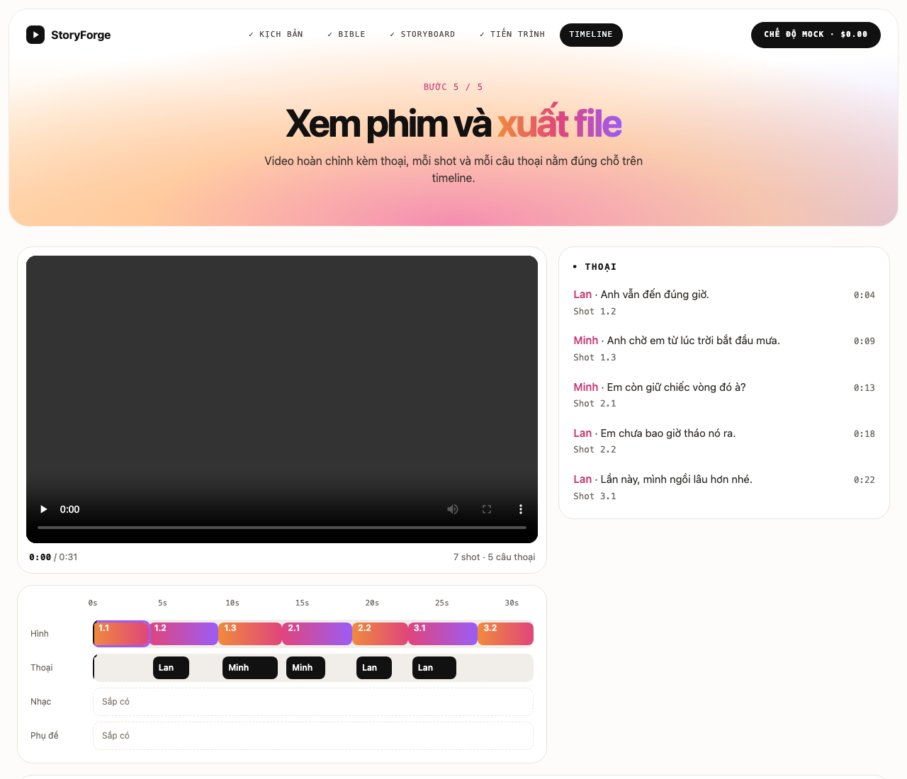
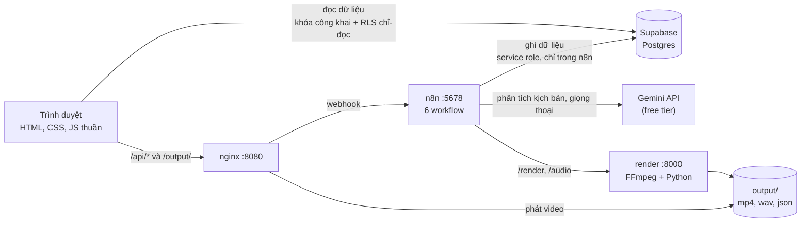
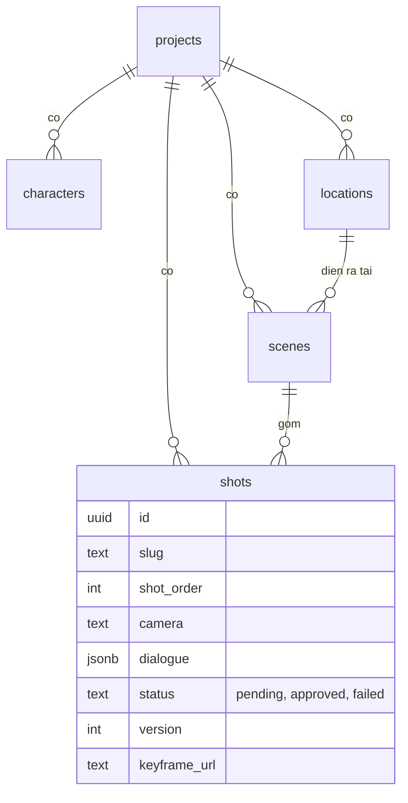

# StoryForge

**Dán kịch bản, nhận video ngắn có thoại.** StoryForge tách kịch bản thành nhân vật, bối cảnh, cảnh và shot, rồi dựng keyframe, giọng thoại và ghép thành video. Mỗi shot là một đối tượng độc lập có trạng thái và phiên bản, nên có thể **tạo lại riêng một shot** mà không phải làm lại cả phim.

> **English summary.** StoryForge is a script-to-short-film pipeline orchestrated with n8n. A screenplay is parsed by Gemini into a structured "Asset Bible" (characters, locations) and independent, versioned shots stored in Supabase. Keyframes, text-to-speech and an FFmpeg render are separate stages behind adapters, so each shot can be approved or regenerated on its own. It runs locally with Docker at **$0** (mock and free tiers). This is a portfolio project; keyframes are still mock images, see [Giới hạn hiện tại](#giới-hạn-hiện-tại).

## Giao diện

Landing và 5 trang theo luồng 5 bước (ảnh chụp từ project mẫu "Đêm Mưa"):

| | |
|---|---|
|  |  |
| **Landing** | **1. Kịch bản**: dán script, bấm phân tích |
|  |  |
| **2. Bible**: nhân vật và bối cảnh | **3. Storyboard**: duyệt hoặc sinh lại từng shot |
|  |  |
| **4. Tiến trình**: chạy từng giai đoạn | **5. Timeline**: phát video, làn Hình và Thoại |

## Ý tưởng cốt lõi

- **Tách Asset Bible khỏi Shot.** Nhân vật và bối cảnh được "khóa" trước (ngoại hình, trang phục, ánh sáng). Mọi shot chỉ được dùng những asset đã khóa, và prompt của từng shot được ghép từ chính Bible đó nên nhân vật nhất quán giữa các shot.
- **Shot độc lập, có phiên bản.** Mỗi shot có `status` (`pending`, `approved`, `failed`) và `version`. Bấm "Sinh lại" ở một shot chỉ tăng `version` của shot đó và dựng lại keyframe của riêng nó.
- **Adapter cho dịch vụ trả phí.** Bước tạo ảnh đi qua một node chọn nhà cung cấp (hiện là `mock`), nên sau này cắm dịch vụ ảnh/video thật mà không phải sửa phần còn lại.

## Kiến trúc



**Workflow n8n** (thư mục [`n8n/`](n8n/)), thứ tự tạo một video là 01, 02, 05, 03:

| # | Workflow | Việc làm |
|---|---|---|
| 01 | Parse kịch bản | Gemini tách kịch bản thành JSON rồi lưu vào 5 bảng |
| 02 | Keyframe | Dựng prompt từ Asset Bible, vẽ keyframe mock qua node adapter |
| 05 | Giọng thoại | Gemini TTS đọc từng câu, giọng chọn theo giới tính nhân vật |
| 03 | Render video | Container FFmpeg ghép keyframe và thoại thành MP4 |
| 06 | Duyệt và sinh lại shot | Duyệt một shot, hoặc tăng phiên bản và dựng lại riêng shot đó |
| 04 | TTS thử | Thử một câu thoại (chỉ để kiểm tra) |

**Mô hình dữ liệu** ([`supabase/schema.sql`](supabase/schema.sql), chi tiết ở [`docs/schema.md`](docs/schema.md)):



## Công nghệ và chi phí

| Thành phần | Dùng để | Chi phí |
|---|---|---|
| n8n (Docker) | Điều phối các bước bằng webhook | Miễn phí, tự chạy |
| Supabase (Postgres, RLS) | Lưu dự án, Asset Bible, shot | Gói free |
| Gemini API | Phân tích kịch bản, giọng thoại | Gói free (có hạn mức, xem bên dưới) |
| FFmpeg + Python (Docker) | Ghép clip, trộn thoại, xuất MP4 | Miễn phí |
| nginx (Docker) | Phục vụ giao diện, chuyển tiếp tới n8n | Miễn phí |

Chi phí chạy thử: **$0** (chế độ mock và free).

## Chạy trên máy

Cần: [Docker Desktop](https://www.docker.com/products/docker-desktop/), một dự án [Supabase](https://supabase.com) miễn phí và một khóa [Gemini API](https://aistudio.google.com) miễn phí. Không cần cài Node hay Python trên máy.

1. **Clone** repo rồi `cd storyforge`.
2. **Supabase:** mở SQL Editor và chạy lần lượt các file trong [`supabase/`](supabase/): `schema.sql`, `save_script.sql`, `keyframes.sql`, `render.sql`, `dialogue.sql`, `web-read.sql`, `shots.sql`.
3. **Bật các dịch vụ:** `docker compose up -d --build` (n8n ở `localhost:5678`, giao diện ở `localhost:8080`, render ở cổng 8000; tất cả chỉ nhận từ chính máy).
4. **n8n:** tạo tài khoản ở lần mở đầu, rồi tạo 2 credential:
   - *Supabase API*: địa chỉ dự án và khóa `service_role` (chỉ đặt trong n8n, không đặt ở đâu khác).
   - *Header Auth* cho Gemini: header `x-goog-api-key` cùng khóa Gemini.
5. **Import** các file `n8n/01, 02, 03, 05, 06`. Trong các node HTTP, đổi địa chỉ Supabase thành dự án của bạn và chọn credential. Ở workflow 01, điền `model_id` (ví dụ `gemini-3.8-flash`). Bấm **Publish** từng workflow.
6. **Giao diện:** sao chép `web/config.example.js` thành `web/config.js`, điền địa chỉ Supabase và khóa **công khai** (`anon`/publishable). Tuyệt đối không dùng `service_role` ở đây.
7. Mở `http://localhost:8080`, vào trang **Kịch bản**, bấm "Dùng kịch bản mẫu" ([`docs/demo-script.md`](docs/demo-script.md)) rồi "Phân tích kịch bản". Sau đó sang trang **Tiến trình** chạy lần lượt Keyframe, Giọng thoại, Render video và xem ở **Timeline**.

Nếu trình duyệt hiện bản giao diện cũ, nạp lại cứng bằng `Cmd + Shift + R`.

## Quyết định kỹ thuật

- **Khóa an toàn.** Trình duyệt chỉ có khóa công khai với quyền đọc do RLS cho phép; mọi thao tác ghi đi qua n8n bằng `service_role`. Khóa bí mật chỉ nằm trong n8n Credentials, `web/config.js` bị `.gitignore`.
- **Hàm Postgres cho thao tác nhiều bảng.** Lưu cả kết quả phân tích vào 5 bảng trong một lần gọi (`save_script`), thay vì nhiều node rời rạc. Các hàm chỉ cấp quyền cho `service_role`.
- **Mỗi dịch vụ một việc.** FFmpeg chạy trong container riêng nên máy không cần cài gì; n8n chỉ điều phối.
- **Bản ghi thời gian.** Container render xuất thêm `output/<project_id>.json` (từng shot và từng câu thoại nằm ở giây nào) để trang Timeline vẽ đúng.
- **nginx chỉ chuyển tiếp 5 địa chỉ webhook** thay vì mở cả n8n ra giao diện.

## Giới hạn hiện tại

Trung thực về những gì chưa có:

- **Keyframe còn là ảnh mock** (nền gradient kèm chữ mô tả), chưa có hình nhân vật hay bối cảnh thật. Nhánh nối dịch vụ ảnh thật đã chừa sẵn ở node adapter nhưng chưa làm.
- **Chưa có chuyển động thật:** video là chuỗi ảnh tĩnh kèm thoại.
- **Giọng thoại bị hạn mức của Gemini free tier** (3 yêu cầu mỗi phút và 10 yêu cầu mỗi ngày cho mỗi model), nên khó tạo nhiều kịch bản trong một ngày.
- **Chưa có** phụ đề, nhạc nền, xuất timeline OTIO; trang Timeline đánh dấu "Sắp có" cho các mục này.
- **Asset Bible chưa có trạng thái khóa** và nút chấp nhận cho nhân vật, bối cảnh (hiện chỉ shot mới có duyệt và sinh lại).
- Nút "Tạo keyframe" ở trang Tiến trình vẽ lại mọi shot, nên nhãn phiên bản trên ảnh mock bị mất (số `version` trong cơ sở dữ liệu vẫn đúng).
- Dự án một người dùng, chạy cục bộ, chưa có đăng nhập; các bảng cho phép khóa công khai **đọc** để phục vụ demo.

## Hướng phát triển

Cắm dịch vụ ảnh/video AI thật vào adapter, trạng thái khóa cho Asset Bible, phụ đề và nhạc nền, tối ưu giọng thoại (bỏ qua câu đã có, lưu từng câu), xuất timeline OTIO để mở tiếp trong DaVinci Resolve hoặc CapCut.

## Cấu trúc thư mục

```
docker-compose.yml   n8n, render, web
docs/                kịch bản mẫu, schema, kết quả mẫu, ảnh chụp giao diện
n8n/                 workflow xuất ra JSON (01 đến 06)
supabase/            SQL: bảng, hàm, quyền đọc cho web
render/              dịch vụ render FFmpeg (Dockerfile, server.py)
nginx/               cấu hình nginx cho giao diện
web/                 giao diện (HTML, CSS, JS thuần)
```

## Ghi chú

Dự án portfolio, xây dựng với sự hỗ trợ của Claude Code. Thiết kế giao diện: nền sáng, gradient cam hồng tím.
