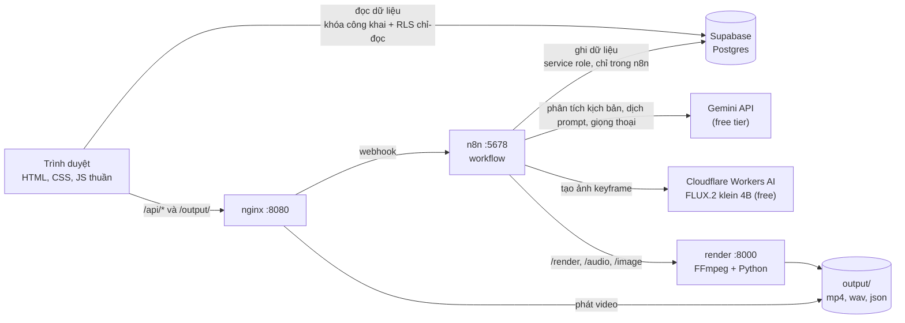
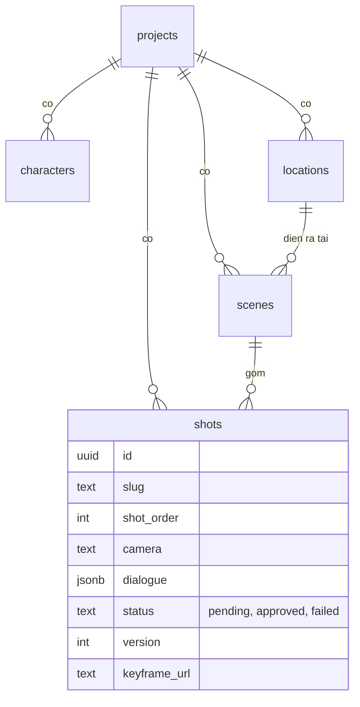

# StoryForge

**Dán kịch bản, nhận video ngắn có thoại.** StoryForge tách kịch bản thành nhân vật, bối cảnh, cảnh và shot, rồi dựng keyframe, giọng thoại và ghép thành video. Mỗi shot là một đối tượng độc lập có trạng thái và phiên bản, nên có thể **tạo lại riêng một shot** mà không phải làm lại cả phim.

> **English summary.** StoryForge is a script-to-short-film pipeline orchestrated with n8n. A screenplay is parsed by Gemini into a structured "Asset Bible" (characters, locations) and independent, versioned shots stored in Supabase. Keyframes, text-to-speech and an FFmpeg render are separate stages behind adapters, so each shot can be approved or regenerated on its own. Keyframes are real cinematic images generated for free with FLUX.2 on Cloudflare Workers AI (prompts are written from the Asset Bible and translated by Gemini), and a mock mode is kept as a fallback. It runs locally with Docker at **$0** (free tiers). This is a portfolio project; characters stay consistent through shared prompt wording, not reference images yet, see [Giới hạn hiện tại](#giới-hạn-hiện-tại).

## Giao diện

Landing và 5 trang theo luồng 5 bước (ảnh chụp từ project mẫu "Đêm Mưa"):

| | |
|---|---|
|  |  |
| **Landing** | **1. Kịch bản**: dán script, bấm phân tích |
|  |  |
| **2. Bible**: nhân vật và bối cảnh | **3. Storyboard**: duyệt hoặc sinh lại từng shot |
|  |  |
| **4. Tiến trình**: chạy từng giai đoạn | **5. Timeline**: phát video, làn Hình và Thoại |

## Ý tưởng cốt lõi

- **Tách Asset Bible khỏi Shot.** Nhân vật và bối cảnh được "khóa" trước (ngoại hình, trang phục, ánh sáng). Mọi shot chỉ được dùng những asset đã khóa, và prompt của từng shot được ghép từ chính Bible đó nên nhân vật nhất quán giữa các shot.
- **Shot độc lập, có phiên bản.** Mỗi shot có `status` (`pending`, `approved`, `failed`) và `version`. Bấm "Sinh lại" ở một shot chỉ tăng `version` của shot đó và dựng lại keyframe của riêng nó.
- **Adapter cho nhà cung cấp ảnh.** Bước tạo ảnh đi qua một node chọn nhà cung cấp: `cloudflare` (ảnh thật, miễn phí) hoặc `mock` (ảnh gradient, dự phòng). Cắm dịch vụ khác (kể cả trả phí) chỉ là thêm một nhánh, phần còn lại không đổi.
- **Prompt ảnh sinh từ Asset Bible.** Ngoại hình, trang phục, phụ kiện của nhân vật và ánh sáng của bối cảnh được ghép vào prompt của từng shot, Gemini dịch sang tiếng Anh một lần cho cả kịch bản để các shot dùng cùng một cách mô tả.

## Kiến trúc



**Workflow n8n** (thư mục [`n8n/`](n8n/)), thứ tự tạo một video là 01, 08, 05, 03:

| # | Workflow | Việc làm |
|---|---|---|
| 01 | Parse kịch bản | Gemini tách kịch bản thành JSON rồi lưu vào 5 bảng |
| 08 | Keyframe ảnh thật | Dựng prompt từ Asset Bible, Gemini dịch sang tiếng Anh, FLUX.2 klein vẽ ảnh 16:9, lưu file và đường dẫn. Có `shot_slug` thì chỉ làm đúng shot đó. Node adapter chọn `cloudflare` hoặc `mock` |
| 05 | Giọng thoại | Gemini TTS đọc từng câu, giọng chọn theo giới tính nhân vật |
| 03 | Render video | Container FFmpeg ghép keyframe và thoại thành MP4 |
| 06 | Duyệt và sinh lại shot | Duyệt một shot, hoặc tăng phiên bản của riêng shot đó (rồi gọi 08 dựng lại ảnh) |
| 02 | Keyframe mock | Bản đầu: vẽ keyframe gradient, còn giữ làm dự phòng |
| 04, 07 | Thử | 04 thử một câu thoại, 07 so sánh hai model ảnh (chỉ để kiểm tra) |

**Mô hình dữ liệu** ([`supabase/schema.sql`](supabase/schema.sql), chi tiết ở [`docs/schema.md`](docs/schema.md)):



## Công nghệ và chi phí

| Thành phần | Dùng để | Chi phí |
|---|---|---|
| n8n (Docker) | Điều phối các bước bằng webhook | Miễn phí, tự chạy |
| Supabase (Postgres, RLS) | Lưu dự án, Asset Bible, shot | Gói free |
| Gemini API | Phân tích kịch bản, dịch prompt, giọng thoại | Gói free (có hạn mức, xem bên dưới) |
| Cloudflare Workers AI (FLUX.2 klein 4B) | Tạo ảnh keyframe | Gói free: 10.000 Neurons mỗi ngày, khoảng 90 ảnh |
| FFmpeg + Python (Docker) | Ghép clip, trộn thoại, xuất MP4 | Miễn phí |
| nginx (Docker) | Phục vụ giao diện, chuyển tiếp tới n8n | Miễn phí |

Chi phí chạy thử: **$0** (chế độ mock và free).

## Chạy trên máy

Cần: [Docker Desktop](https://www.docker.com/products/docker-desktop/), một dự án [Supabase](https://supabase.com) miễn phí, một khóa [Gemini API](https://aistudio.google.com) miễn phí và một tài khoản [Cloudflare](https://dash.cloudflare.com) miễn phí (lấy Account ID và API token của Workers AI). Không cần cài Node hay Python trên máy.

1. **Clone** repo rồi `cd storyforge`.
2. **Supabase:** mở SQL Editor và chạy lần lượt các file trong [`supabase/`](supabase/): `schema.sql`, `save_script.sql`, `keyframes.sql`, `render.sql`, `dialogue.sql`, `web-read.sql`, `shots.sql`.
3. **Bật các dịch vụ:** `docker compose up -d --build` (n8n ở `localhost:5678`, giao diện ở `localhost:8080`, render ở cổng 8000; tất cả chỉ nhận từ chính máy).
4. **n8n:** tạo tài khoản ở lần mở đầu, rồi tạo 3 credential:
   - *Supabase API*: địa chỉ dự án và khóa `service_role` (chỉ đặt trong n8n, không đặt ở đâu khác).
   - *Header Auth* cho Gemini: header `x-goog-api-key` cùng khóa Gemini.
   - *Header Auth* cho Cloudflare: header `Authorization`, giá trị `Bearer <API token>`.
5. **Import** các file `n8n/01, 03, 05, 06, 08` (02 là bản mock dự phòng, 04 và 07 chỉ để thử). Trong các node HTTP, đổi địa chỉ Supabase thành dự án của bạn và chọn credential. Điền `model_id` Gemini ở workflow 01 và 08 (khuyên dùng `gemini-3.5-flash-lite`; model `gemini-3.8-flash` hay bị treo ở gói free). Ở workflow 08, node **Cấu hình**, điền `account_id` là Account ID Cloudflare của bạn (tên trường đúng là `account_id`). Bấm **Publish** từng workflow, và Publish lại mỗi khi sửa.
6. **Giao diện:** sao chép `web/config.example.js` thành `web/config.js`, điền địa chỉ Supabase và khóa **công khai** (`anon`/publishable). Tuyệt đối không dùng `service_role` ở đây.
7. Mở `http://localhost:8080`, vào trang **Kịch bản**, bấm "Dùng kịch bản mẫu" ([`docs/demo-script.md`](docs/demo-script.md)) rồi "Phân tích kịch bản". Sau đó sang trang **Tiến trình** chạy lần lượt Keyframe, Giọng thoại, Render video và xem ở **Timeline**.

Nếu trình duyệt hiện bản giao diện cũ, nạp lại cứng bằng `Cmd + Shift + R`.

## Quyết định kỹ thuật

- **Khóa an toàn.** Trình duyệt chỉ có khóa công khai với quyền đọc do RLS cho phép; mọi thao tác ghi đi qua n8n bằng `service_role`. Khóa bí mật chỉ nằm trong n8n Credentials, `web/config.js` bị `.gitignore`.
- **Hàm Postgres cho thao tác nhiều bảng.** Lưu cả kết quả phân tích vào 5 bảng trong một lần gọi (`save_script`), thay vì nhiều node rời rạc. Các hàm chỉ cấp quyền cho `service_role`.
- **Mỗi dịch vụ một việc.** FFmpeg chạy trong container riêng nên máy không cần cài gì; n8n chỉ điều phối.
- **Bản ghi thời gian.** Container render xuất thêm `output/<project_id>.json` (từng shot và từng câu thoại nằm ở giây nào) để trang Timeline vẽ đúng.
- **nginx chỉ chuyển tiếp 6 địa chỉ webhook** thay vì mở cả n8n ra giao diện.
- **Đã so sánh trước khi chọn model ảnh.** Mình dựng workflow thử sinh cùng một prompt bằng FLUX.1 schnell và FLUX.2 klein 4B rồi chọn bằng mắt. Gemini tạo ảnh bị loại vì không có gói miễn phí; FLUX.2 klein 9B và dev bị loại vì chỉ đủ vài ảnh mỗi ngày trong hạn mức free.

## Giới hạn hiện tại

Trung thực về những gì chưa có:

- **Nhân vật nhất quán nhờ prompt, chưa nhờ ảnh tham chiếu.** Trang phục và đặc điểm (kính, áo, tóc, phụ kiện) giữ ổn định giữa các shot, nhưng khuôn mặt của cùng một nhân vật chưa chắc giống hệt. FLUX.2 hỗ trợ ảnh tham chiếu nên đây là hướng nâng cấp tiếp theo.
- **Chưa có chuyển động thật:** video là chuỗi ảnh tĩnh (keyframe) kèm thoại. Ảnh cho cả hai nhân vật hơi "AI" (da mịn, vài chi tiết lạ), và một lần chạy cả kịch bản tốn khoảng 800 Neurons.
- **Hạn mức ảnh:** gói free Cloudflare cho 10.000 Neurons mỗi ngày (khoảng 90 ảnh), hồi lại lúc 00:00 UTC.
- **Giọng thoại bị hạn mức của Gemini free tier** (3 yêu cầu mỗi phút và 10 yêu cầu mỗi ngày cho mỗi model), nên khó tạo nhiều kịch bản trong một ngày.
- **Chưa có** phụ đề, nhạc nền, xuất timeline OTIO; trang Timeline đánh dấu "Sắp có" cho các mục này.
- **Asset Bible chưa có trạng thái khóa** và nút chấp nhận cho nhân vật, bối cảnh (hiện chỉ shot mới có duyệt và sinh lại).
- Sinh lại một shot dịch prompt riêng cho shot đó, nên cách mô tả nhân vật có thể lệch nhẹ so với các shot cũ.
- Dự án một người dùng, chạy cục bộ, chưa có đăng nhập; các bảng cho phép khóa công khai **đọc** để phục vụ demo.

## Hướng phát triển

Dùng ảnh tham chiếu (chân dung nhân vật tạo trước) để khuôn mặt nhất quán, thêm nhánh video AI vào adapter để có chuyển động, trạng thái khóa cho Asset Bible, phụ đề và nhạc nền, tối ưu giọng thoại (bỏ qua câu đã có, lưu từng câu), xuất timeline OTIO để mở tiếp trong DaVinci Resolve hoặc CapCut.

## Cấu trúc thư mục

```
docker-compose.yml   n8n, render, web
docs/                kịch bản mẫu, schema, kết quả mẫu, ảnh chụp giao diện
n8n/                 workflow xuất ra JSON (01 đến 08)
supabase/            SQL: bảng, hàm, quyền đọc cho web
render/              dịch vụ render FFmpeg (Dockerfile, server.py)
nginx/               cấu hình nginx cho giao diện
web/                 giao diện (HTML, CSS, JS thuần)
```

## Ghi chú

Dự án portfolio, xây dựng với sự hỗ trợ của Claude Code. Thiết kế giao diện: nền sáng, gradient cam hồng tím.
